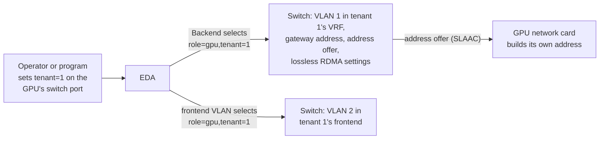

# Giving GPUs to tenants with labels: EDA REST API or Terraform

## In one minute

A shared GPU cluster rents its GPUs to several users or teams, called **tenants**. Each GPU has its own network card,
cabled to its own switch port. Giving a GPU to a tenant therefore means putting that switch port into the tenant's
private network, and taking the GPU back means taking the port out again.

In this fabric, Nokia EDA (the automation platform that configures the switches) does all the switch work. A
person or a program only has to set **one label on the switch port**: `tenant=1` puts the GPU into tenant 1,
removing the label frees the GPU. This document explains:

1. where that label lives and what EDA configures on the switch because of it;
2. how the fabric knows which GPU is behind which switch port, and how LLDP keeps that knowledge honest;
3. two ways to automate the label, and every check each one makes before changing anything:
   - a small program that talks to EDA's **REST API**;
   - **Terraform**, the infrastructure-as-code tool;
4. the pros and cons of each, and when to use which.

Both tools were built and measured on this demo lab: Nokia EDA 26.8.2 with simulated SR Linux switches, 16 GPUs
in 4 servers, and 2 tenants.

## The words used here

| Term | Meaning |
|---|---|
| **GPU server, NIC, rail** | Each server has 4 GPUs. Each GPU has its own network card (NIC), cabled to a different switch: GPU 0 of every server to switch `l1-1`, GPU 1 to `l1-2`, and so on. Each such switch is a "rail". A GPU is named `gpu-<server>-g<index>`, e.g. `gpu-3-g2` = GPU 2 of server 3. |
| **Leaf, spine** | The leaves are the switches the GPUs plug into; the spines connect the leaves to each other. |
| **Tenant** | A user, team or company that rents GPUs. Tenants must never reach each other's GPUs. |
| **VRF** | A private routing table on a switch. Each tenant has its own, which is what keeps tenants apart. |
| **VLAN** | A tag that splits one cable into separate networks. Each GPU cable carries VLAN 1 (the GPU-to-GPU network, also called backend) and VLAN 2 (the frontend: storage and services). |
| **EDA** | Nokia's Event-Driven Automation. You describe what you want as objects ("this port belongs to tenant 1"), and EDA works out and pushes the switch configuration, and keeps it in sync. |
| **Object** | An entry in EDA's database, written in YAML, e.g. an `Interface` (one switch port) or a `Backend` (the whole GPU fabric design). |
| **Label** | A `key=value` tag on an object, such as `tenant=1`. Labels don't configure anything by themselves; other objects **select** ports by their labels. |
| **Transaction** | One change submitted to EDA. EDA applies all of it to the switches or none of it, and can **revert** it later. |
| **Dry run** | A transaction that is only checked: EDA reports the exact switch configuration it would push, and pushes nothing. |
| **LLDP** | A small protocol where every network card announces "I am X" to the switch port it is plugged into. |
| **SLAAC** | A way for an IPv6 device to build its own address from what the switch announces, without DHCP. |
| **REST API** | EDA's web interface for programs: they read and change objects over HTTPS. |
| **Terraform** | A widely used tool that keeps infrastructure in line with a desired state written in files. `terraform plan` shows what it would change, `terraform apply` changes it, and a **state** file records what it manages. |

## 1. Where the label is, and what it does

### The label sits on the switch port's Interface object

EDA keeps one `Interface` object per switch port. The port of GPU `gpu-1-g2` (switch `l1-3`, port `ethernet-1/1/1`)
looks like this (trimmed):

```yaml
metadata:
  name: l1-3-ethernet-1-1-1
  labels:
    role: gpu            # this port has a GPU behind it
    gpu-server: gpu-1    # which server the topology says is cabled here
    rail: "3"            # which GPU of that server (rail 3 = GPU 2)
    tenant: "1"          # THE booking: this GPU belongs to tenant 1. No tenant label = free GPU
spec:
  members:
    - node: l1-3                 # the switch
      interface: ethernet-1-1-1  # the port
status:
  members:
    - lldpOperationalState: Aligned               # what LLDP sees matches the cabling plan
      neighbors: [ { node: gpu-1-g2, interface: eth1 } ]   # the card that LLDP sees on this port
```

Only the `tenant` label changes when a GPU is booked, moved or released. The other labels come from the cabling plan
and never change.

### Two objects read the label

The fabric design is written once, up front, and selects ports by label:

```yaml
# Backend (the GPU fabric): one isolation group = one private network (VRF) per tenant
gpuIsolationGroups:
  - { name: tenant-1, interfaceSelectors: [ "role=gpu,tenant=1" ] }
  - { name: tenant-2, interfaceSelectors: [ "role=gpu,tenant=2" ] }

# Frontend network of tenant 1: VLAN 2 on every port that carries the same label
vlans:
  - name: fe-tenant-1-vlan2
    spec: { vlanID: "2", interfaceSelectors: [ "role=gpu,tenant=1" ] }
```

So when a port gets `tenant=1`, it starts matching tenant 1's isolation group and tenant 1's frontend VLAN, and EDA
configures it for both. When the label is removed, the port matches nothing and EDA removes that configuration.



### What EDA configures on the switch

Booking the free GPU `gpu-3-g2` for tenant 1 adds 104 lines of configuration, and only on its own switch (`l1-3`).
Nothing changes on any other switch: the other leaves learn the new address automatically through EVPN, the
protocol the switches use to exchange tenant routes. Here are the lines, trimmed, with comments added:

```
interface ethernet-1/2/1 {                       # the GPU's port
    ethernet { flow-control { receive false } }  # prerequisite for lossless RDMA
    subinterface 1 {                             # VLAN 1 = GPU-to-GPU traffic (RDMA)
        type routed
        ip-mtu 4200
        ipv6 {
            address fd00:100:301:201::1/64       # the GPU's gateway
            router-advertisement {               # the switch offers the network to the GPU:
                router-role {
                    prefix fd00:100:301:201::/64 { autonomous-flag true }   # "build your address in here"
                }
            }
        }
        vlan { encap { single-tagged { vlan-id 1 } } }
    }
    subinterface 2 {                             # VLAN 2 = frontend
        type bridged
        vlan { encap { single-tagged { vlan-id 2 } } }
    }
}
network-instance tenant-1 {                      # tenant 1's private routing table (VRF)
    interface ethernet-1/2/1.1 { }
}
network-instance fe-tenant-1-bd {                # tenant 1's frontend network
    interface ethernet-1/2/1.2 { }
}
qos {                                            # quality of service for RDMA
    interfaces {
        interface ethernet-1/2/1 {
            pfc { pfc-enable true }              # pause frames: RDMA traffic is never dropped
            output { scheduler { scheduler-policy egress-backend-aifabric } }   # + buffer and queue profiles
        }
        interface ethernet-1/2/1.1 { input { classifiers { dscp-policy edgesubinterface-ingress-aifabric } } }
        interface ethernet-1/2/1.2 { input { classifiers { dscp-policy frontend-ingress } } }
    }
}
```

- **Releasing** a GPU removes exactly these lines.
- If it was the tenant's last GPU on that switch, EDA also removes the tenant's whole routing instance from the
  switch: 145 lines for `gpu-1-g2`, tenant 1's only GPU on `l1-3`.
- A free port carries no tenant network at all.

The address is fixed per port. EDA computes each GPU port's network from the switch and the port:
`fd00:100:<leaf>01:<port>0<channel>::/64`. The switch is always `::1` of it, which is the GPU's gateway. A GPU gets
the same network and gateway every time it is booked, and keeps them when it moves to the other tenant; only the VRF
changes. `README.md` lists the gateway of all 16 GPUs.

### What the GPU does by itself

The GPU's operating system accepts the switch's address offer and builds its address from it (SLAAC; the host part
comes from the card's hardware address). In the lab, a small agent on each GPU does the rest:

- it pings its gateway every second, which shows the GPU is reachable and keeps the switch's address table fresh;
- it drops the address when the switch stops offering it.

Nobody configures anything on the GPU when it is booked or released. The frontend (VLAN 2) address is still static
in this lab; a helper (`hosts.sh --follow`) sets it when a label changes.

## 2. Which switch port belongs to which GPU

The label goes on a **switch port**, but the operator thinks in **GPUs** ("give `gpu-3-g2` to tenant 1"). Something
has to translate GPU to port, and that translation must be right. Otherwise the tenant gets a different GPU than the
one it paid for: possibly a GPU on the wrong rail, or one already in use by someone else.

### Two sources that must agree

1. **EDA's inventory: the plan.** The cabling plan (EDA's topology) says which card is cabled to which port. EDA
   copies it onto the port as the labels `gpu-server` and `rail`. From these, `gpu-server=gpu-3` + `rail=3` = GPU 2
   of server 3 = `gpu-3-g2`.
2. **LLDP: the reality.** Every GPU's card announces its name on its cable, and the switch records who it sees on
   each port. EDA collects this for every port; it is the `neighbors` field above.

Both tools refuse to change anything unless both sources name the same GPU on the same port.

### When they disagree: crossed cables

Suppose the cables of `gpu-4-g2` and `gpu-4-g3` were swapped during installation. The plan says `gpu-4-g2` is on
`l1-3 ethernet-1/2/2`, but LLDP sees `gpu-4-g3` there, and the other way round on `l1-4`. Tested on the lab:

- **EDA notices within about 20 s.**
  - Both ports' LLDP state turns from `Aligned` to `Misaligned`.
  - EDA raises a **major alarm** per cable, for example: "Expected neighbor on interface l1-4-ethernet-1-2-2 is
    [gpu-4-g3, eth1] but found [gpu-4-g2, eth1]", with the advice "Verify cabling…". The alarm clears by itself once
    the cabling is right.
- **EDA does not stop you.** A booking on a misaligned port still passes EDA's dry run, because to EDA a label is
  just a label. Booking `gpu-4-g2` by the plan would label `l1-3 ethernet-1/2/2`, and the GPU really behind that
  port, `gpu-4-g3`, would join the tenant.
- **Both tools stop here.** They refuse before sending anything, and show both views:

  ```
  REFUSED, nothing sent to EDA:
  gpu-4-g2: inventory and switches disagree: EDA's labels put it on l1-3 ethernet-1/2/2,
  LLDP sees it on l1-4 ethernet-1/2/2 => fix the cabling or the topology first
  ```

- **A GPU whose card is silent** (no LLDP neighbour on its port: card down, or LLDP not running) is refused the same
  way: nothing proves which GPU is there.

The refusal is deliberate: a crossed cable has to be fixed, not booked around.

In this lab each GPU runs as its own small virtual machine, so its LLDP name is the GPU name. On real GPU servers
LLDP names the server and the network-card port, and the GPU index comes from which card is wired to which GPU. The
check works the same way.

### Why not use the IPv6 addresses for this?

The switch also learns each GPU's IPv6 address and card hardware address (IPv6 neighbour discovery), but that
cannot identify a GPU before it is booked:

- it carries no name;
- a free port has no network, so no address appears on it at all.

It is used afterwards, as proof. Once a booking is done, the switch must have learned an address in that port's
network, from the card whose hardware address LLDP reported. That proves the right card took the address, in the
right tenant's VRF.

## 3. How each approach sets the label

Both tools change only the `tenant` label, and EDA turns the label into switch configuration exactly the same way
whichever tool set it. Both log in as their own limited EDA user, which may read the fabric and change port objects,
and nothing else. So EDA's Transactions page always shows which tool made a change, and neither tool can touch the
fabric design.

### Approach A: a program on EDA's REST API (`automation/gpu-tenant.py`)

The operator asks for an action; the program carries it out and stops when the GPU works.

```bash
python3 automation/gpu-tenant.py assign tenant-1 gpu-3-g2     # book (gpu-3 alone = all 4 GPUs of server 3)
python3 automation/gpu-tenant.py assign tenant-2 gpu-3-g2 --move
python3 automation/gpu-tenant.py unassign gpu-3-g2              # release
python3 automation/gpu-tenant.py apply automation/tenancy.yaml  # make the fabric match a list of all GPUs
python3 automation/gpu-tenant.py list                           # every GPU: port, LLDP check, tenant, address
```

**What happens on `assign tenant-1 gpu-3-g2`**

1. **Log in** to EDA. Two runs that start at the very same moment can be refused by EDA's login service, so the
   program retries.
2. **Read the live state** through the REST API:
   - every GPU port with its labels;
   - every port's LLDP neighbour;
   - the list of tenants, read from the Backend's isolation groups.
3. **Check everything** (below). If any check fails, the whole command is refused and nothing is sent.
4. **Prepare the change**: for each port, "set `tenant` to `1`", preceded by a condition: "only if this port's labels
   are still exactly what I just read". If someone else changed the port in the meantime, EDA rejects the whole
   change. This is called compare-and-swap.
5. **Dry run**: EDA checks the change and names the switches it would touch.
6. **Commit**: the same change as **one transaction for all GPUs of the command**. Either all of them change, or
   none.
7. **Confirm**:
   - the switch shows the port in tenant 1's VRF;
   - the switch has learned the GPU's address from the right card;
   - the labels are re-read once more. If another operator changed the same GPU during the run, the program says so
     and ends with an error.

Exit codes tell a calling system what happened: 0 done, 1 refused by EDA or overtaken by someone else, 2 refused
before anything was sent.

### Approach B: Terraform with Nokia's EDA providers (`automation/terraform/`)

The operator edits the desired state, a file listing all 16 GPUs, and asks Terraform to make EDA match it.

```yaml
# automation/tenancy.yaml (excerpt)
gpu-3-g1: tenant-2
gpu-3-g2: tenant-1      # was: free
gpu-3-g3: free
```

```bash
cd automation/terraform
python3 setup.py     # once per lab: Terraform's EDA user, connection settings, download of Nokia's providers
terraform plan       # show the difference and EDA's dry-run verdict
terraform apply      # make the change
```

**What happens on `terraform plan`, then `terraform apply`**

1. **Read the live state** with Nokia's providers (Terraform plug-ins, one per EDA application):
   - every GPU port, with its labels and its LLDP neighbour;
   - the list of tenants, from the Backend.
2. **Check everything** (below). If any check fails, the plan stops with an error and nothing is sent.
3. **Compare** each port's current `tenant` label with the file. Only the differences become changes. The first
   plan also **adopts** the 16 ports into Terraform. They already exist, so Terraform takes them over instead of
   creating them, and from then on manages only their `tenant` label.
4. **Dry run**: the plan shows EDA's verdict on exactly these changes, and which switches they touch.
5. **Apply**: Nokia's provider writes each changed port object to EDA separately, so **each port is its own
   transaction**.
6. **Afterwards**: on the next plan, Terraform reads the switches. Are the booked ports in their tenant's VRF, and
   have the GPUs taken their addresses? If not, it prints a warning. It does not wait for the fabric.

Terraform is also protected against deleting ports. Removing a GPU from Terraform's control would normally delete
the object, and here that object is a switch port, so the project forbids it. To release a GPU, set it to `free`.

### All the checks, side by side

| Check before changing a label | REST API program | Terraform |
|---|---|---|
| The tenant exists (read from the Backend) | yes, refused before EDA | yes, the plan stops |
| The GPU exists (a port in the inventory, or an LLDP neighbour, has its name) | yes | yes |
| The plan and LLDP put the GPU on the same port (exactly one port) | yes, for the GPUs in the command | yes, for **every** GPU in the file |
| The GPU's card is alive (an LLDP neighbour is present) | yes | yes |
| Each GPU is listed only once | yes | yes, checked separately: the YAML reader alone would silently keep the last of two lines |
| The GPU name is well formed | yes | a misspelt name is refused as an unknown GPU |
| **Is a label already set?** The current label is read live and compared | yes, just before acting | yes, Terraform refreshes from EDA during the plan |
| Already in the requested tenant: nothing is sent | yes | yes |
| The GPU belongs to another tenant | refused unless `--move` (or `apply` of a file) | changed if the file says so (visible in the plan) |
| EDA's dry run must pass first | yes, always | yes, during the plan |
| Nobody changed the port since it was read (compare-and-swap) | yes: EDA rejects a stale change | **no**: applying a saved plan overwrote a label someone changed in between, without a warning |
| Two operators at the same moment | compare-and-swap, plus a re-check after the commit | Terraform's state lock refuses the second run, but only for operators sharing the same state |
| A port object can never be deleted | the program only edits labels | `prevent_destroy` refuses any plan that would |
| After the change: switch configured, GPU addressed | waited for and proven | warning on the next plan only |

### Two ways to build the Terraform side

There are two ways to connect Terraform to EDA, and they behave differently.

- **Nokia's typed resources** (this lab). Terraform holds each port object and reads it back on every plan.
  - So it **sees and reverts** any label changed elsewhere: in EDA's GUI, by another tool, or by an EDA revert.
  - It writes each object through that application's REST interface, not through EDA's transaction service (stated
    in Nokia's EDA 26.8 documentation). So every port is its own transaction, and EDA's history describes each one
    only as "REST".
  - It owns the whole port object, which is why adopting existing ports needs care.
  - Nokia's typed resources have no dry run; the plan adds one through a direct REST call.
- **Terraform posting EDA transactions over REST** (used in another EDA demo, "nebnok").
  - Many objects can go into one transaction, each with a clear description, and four-eyes merge requests work.
  - But Terraform then only remembers the transactions it sent, not the labels, so it is **blind** to changes made
    elsewhere.
  - Undoing relies on EDA reverts, which fail when EDA has bundled transactions sent at the same moment, so explicit
    undo transactions are needed.

With either design, Terraform can own more than labels. In the nebnok demo one `terraform apply` onboards a whole
tenant: network, routing, 4 GPU bookings, a tenant login and validation checks, 27 resources. That apply took about
2 minutes and the removal under 1 minute. Growing a tenant from 4 to 6 GPUs touched only the 2 new ones: 0 of 599
pings were lost on a GPU that stayed.

## 4. Side by side: measured on the lab

| | REST API program | Terraform (label only) |
|---|---|---|
| Book one free GPU | 5.4-8.8 s, until the GPU is proven on its port | plan 5.3 s + apply 5.3 s |
| Move a GPU to the other tenant | 4.3 s (address kept) | plan 5.2 s + apply 5.3 s |
| Release a GPU | 3.2 s | plan 5.6 s + apply 5.4 s |
| Book 4 GPUs at once | one transaction, 6.5 s | one transaction per GPU (EDA bundled some), about 9 s |
| One of them is miscabled | that GPU refused, the rest can be booked | the whole plan refused |
| A label changed in the GUI | shown by `list`; only `apply --dry-run` shows it differs from the file | the next plan shows it and the apply reverts it |
| EDA reverts the tool's change | the revert stands; the program keeps no memory | the next plan sees it and re-applies the file |
| Same GPU changed by two operators | the later change is refused by EDA, or detected right after | same working copy: locked out; a stale saved plan: silently overwrites |
| EDA's history | "gpu-tenant.py: assign to tenant-1: gpu-3-g2 tenant-1", plus its dry run | each change "REST", user `gpu-terraform`; the dry run is described |
| Size | 354 lines of Python + a 133-line shared login library | 251 lines of Terraform code in 8 files + a 57-line setup script |
| Needs | Python 3.9 or newer, nothing else | Terraform (123 MiB) + 4 providers (89 MiB) from the internet registry. An offline site needs a local mirror |

The switch configuration is identical whichever tool set the label. The GPU behaves the same too: it doesn't know
who made the change.

## 5. Pros and cons

### REST API program

**Pros**

- **Fast and event-driven.** A change takes seconds and can be triggered by anything: a GPU scheduler, a self-service
  portal, a ticket. That matches how GPUs are actually rented: per job, per tenant.
- **Atomic.** Every command is one transaction: all its GPUs change, or none.
- **Changes only the label.** It never takes over the port object, so nothing can delete a port by accident.
- **Safe with several operators,** with no state file: compare-and-swap makes EDA refuse a change based on stale
  information.
- **Clear audit trail.** Every transaction in EDA says what was done to which GPU.
- **All of EDA's safety features are available:** dry run, revert, merge requests (four-eyes, not used here) and a
  least-privilege user.
- **Light.** Needs only Python, works offline, and is easy to embed in any platform.

**Cons**

- **You build and maintain it:**
  - login and retries;
  - reading the fabric, and the checks;
  - error handling;
  - every new feature, such as a merge-request mode, plus keeping up with new EDA API versions.
- **The intent lives in the caller.** "Tenant 1 should have these 6 GPUs" is wherever the scheduler or the operator
  keeps it. Nothing compares EDA against it unless you ask (`apply --dry-run`), so a change made in EDA's GUI goes
  unnoticed.
- **One gap in the safety net.** Two commits by the same EDA user in the very same instant are bundled together by
  EDA, and both pass the compare-and-swap. The program detects this after the fact and reports it, but cannot
  prevent it.
- **No review step** unless you add one, such as EDA merge requests.

### Terraform

**Pros**

- **The desired state is a file.** It is readable, versioned in git and reviewed in a pull request, and
  `terraform plan` shows the exact change together with EDA's own dry-run verdict before anything happens.
- **Drift is detected and corrected.** A label changed in the GUI, by another tool or by an EDA revert shows up in
  the next plan, and the next apply puts the file's state back.
- **Differences are computed for you.** Growing or shrinking a tenant changes only the GPUs that differ.
- **A standard tool many teams already run in CI pipelines,** with state and locking. The same project can manage
  the tenants themselves (networks, isolation groups, logins), not just the GPU bookings.

**Cons**

- **Hard to read.** One label change shows up in the plan surrounded by about 45 lines of "(known after apply)".
- **Needs careful wiring** to manage objects that Terraform did not create. The ports must be adopted, Terraform must
  be kept away from the rest of each port object, and deletion must be forbidden. Gaps in Nokia's providers on EDA
  26.8.2 needed extra REST calls:
  - no native dry run;
  - the merge-request resource drops its contents;
  - reverts fail for bundled transactions;
  - an older label-filter setting is ignored (the newer `label_selector` works).
- **Does not wait for the fabric.** Its after-checks only warn, and only on the next plan.
- **Per-file strictness.** One miscabled GPU anywhere in the file blocks every change.
- **A stale saved plan wins.** A label changed after `terraform plan -out` is silently overwritten by `apply`. Run
  `terraform apply` without a saved plan, which plans again first, or keep the time between plan and apply short.
- **A state file to protect and share.** Locking only helps operators who share that state, so a team needs a shared
  remote backend.
- **Heavier and slower.** A label change takes about 10.5 s instead of about 5 s. A full tenant onboarding takes
  minutes. 212 MiB of software to install, or to mirror for an offline site.

## 6. Which one, when

- **Day-to-day GPU booking: the REST API.** Bookings come from a scheduler or portal, often and per job. They need to
  be atomic, immediate and proven. Use a program like `gpu-tenant.py`, or the same logic inside the scheduler, with
  a least-privilege EDA user.
- **The tenant lifecycle: Terraform.** Onboarding a tenant, its quota and its removal change rarely and deserve
  review, and that is where a desired-state file in git shines. It also suits a GPU allocation that changes rarely
  and is reviewed, such as a quarterly contract.
- **One owner per label.** Never let two tools manage the same `tenant` labels. If Terraform owns them, every booking
  made another way is "drift" that the next `terraform apply` reverts.
- **A possible next step (an idea, not built or tested here).** Model the booking itself as an EDA object, e.g. one
  "GPU allocation" per tenant, handled by a small custom EDA application that sets the port labels. The GUI, the REST
  API and Terraform would then all change that one object, and EDA would provide dry run, revert and merge requests
  for bookings natively. The cost is building and maintaining that application.

## Not covered here

- a shared Terraform state used by a team;
- merge requests (four-eyes approval) for either tool;
- real GPU servers, whose LLDP names the server and the card port;
- DHCP for the frontend addresses: EDA's DHCP relay did not work across this frontend's route-leaked design, so the
  frontend addresses stay static.
